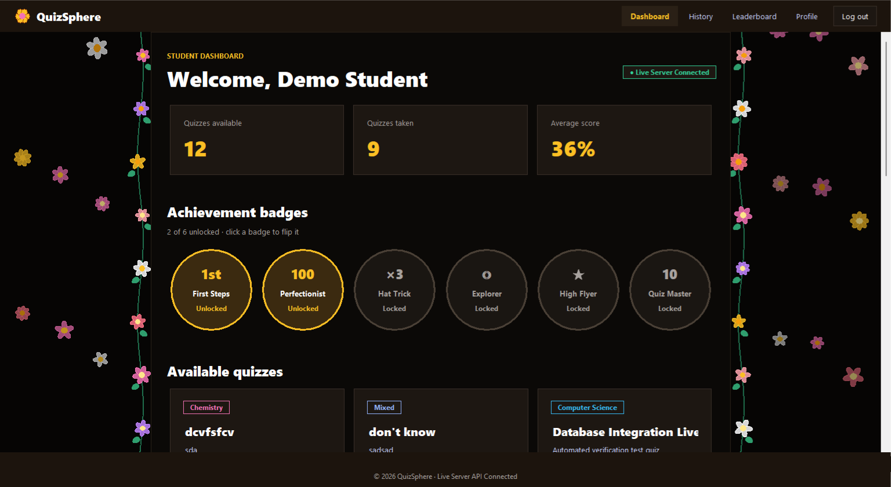
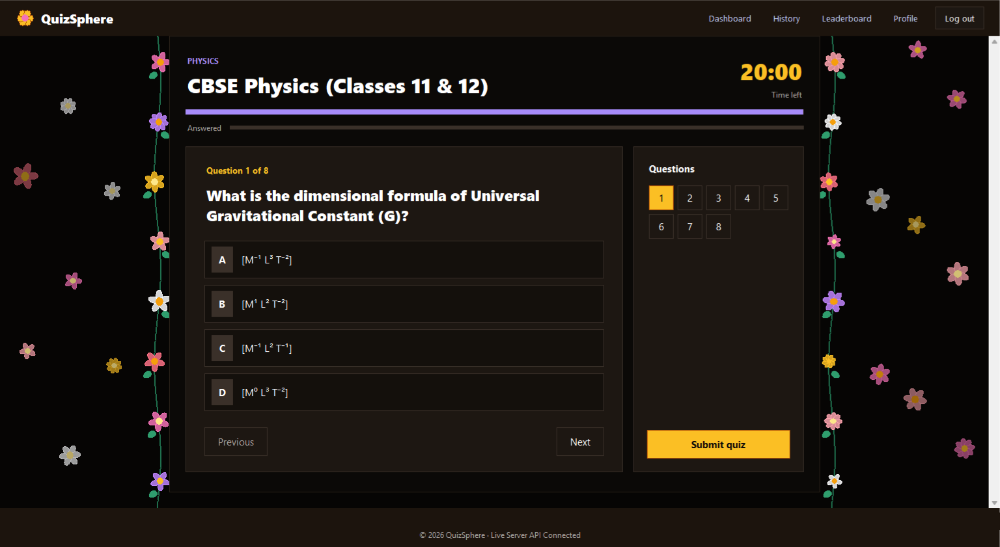
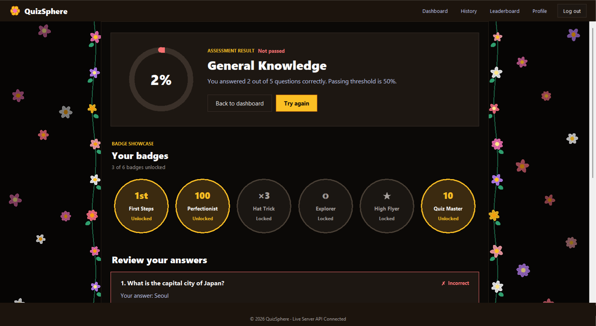
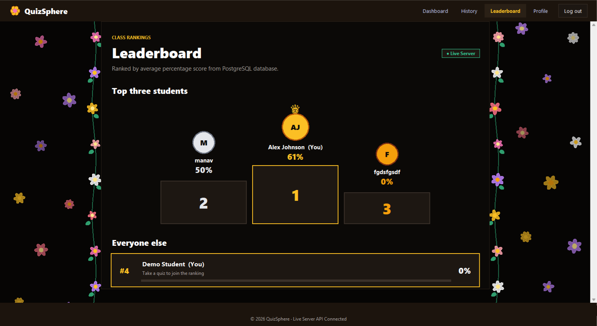

# QuizLog

QuizLog is a quiz and assessment platform with a Python desktop application, a FastAPI backend, and PostgreSQL storage. Students can take timed quizzes and review their results; instructors can create quizzes and view assessment analytics.

## Screenshots

### Student dashboard



### Timed quiz



### Assessment results



### Leaderboard



## Features

- Student and instructor registration, authentication, and role-based dashboards.
- Timed multiple-choice assessments with question navigation.
- Server-side answer validation and grading when the API is available.
- Results, answer explanations, attempt history, achievement badges, and a leaderboard.
- Instructor tools for quiz creation and assessment analytics.
- Offline demo mode with local data when the backend is unavailable.

## Technology

| Component | Technologies |
|---|---|
| Desktop application | Python, Tkinter |
| API | FastAPI, SQLAlchemy, Pydantic Settings |
| Database | PostgreSQL |
| Authentication | JWT bearer tokens, Argon2 password hashing |

The desktop application uses Python's standard library for HTTP requests. Backend dependencies are listed in `requirements.txt`.

## Requirements

- Python 3.11 or newer
- PostgreSQL 14 or newer
- Tkinter, typically included with Python

## Getting started

### 1. Create a database

Create a PostgreSQL database for QuizLog:

```sql
CREATE DATABASE quiz_platform;
```

### 2. Configure the backend

From the project root, copy the example environment file:

```powershell
Copy-Item .env.example .env
```

Edit `.env` and set `DATABASE_URL` to match your PostgreSQL username and password. Generate a unique signing key:

```powershell
python -c "import secrets; print(secrets.token_urlsafe(32))"
```

Set the generated value as `SECRET_KEY`. Do not commit `.env`; it is excluded by `.gitignore`.

### 3. Install dependencies and start the API

Run these commands from the project root:

```powershell
python -m venv .venv
.\.venv\Scripts\Activate.ps1
python -m pip install -r requirements.txt
uvicorn backend.main:app --reload --port 8000
```

On startup, the backend creates the database tables and seeds demo accounts and quizzes when the database is empty.

- API documentation: [http://127.0.0.1:8000/docs](http://127.0.0.1:8000/docs)
- Health check: [http://127.0.0.1:8000/api/health](http://127.0.0.1:8000/api/health)

### 4. Start the desktop application

Keep the API running, open a second terminal at the project root, and run:

```powershell
Set-Location frontend\quizsphere-frontend-python\frontend
python main.py
```

The desktop application connects to `http://127.0.0.1:8000/api`. If the API is unavailable, it uses local demo data instead.

## Demo accounts

The backend seeds these accounts when its database is empty:

| Role | Email | Password |
|---|---|---|
| Student | `student@college.edu` | `student123` |
| Instructor | `instructor@college.edu` | `instructor123` |

These are development credentials. Change or remove them before using the application outside a local demo environment.

## API endpoints

| Method | Endpoint | Description |
|---|---|---|
| GET | `/api/health` | Check API and database connectivity |
| POST | `/api/auth/register` | Register an account |
| POST | `/api/auth/login` | Authenticate and obtain a bearer token |
| GET | `/api/auth/me` | Get the authenticated user's profile |
| GET, POST | `/api/quizzes` | List quizzes or create a quiz |
| GET, PUT, DELETE | `/api/quizzes/{quiz_id}` | Get, update, or delete a quiz |
| GET | `/api/quizzes/{quiz_id}/questions` | Get quiz questions for an assessment |
| POST | `/api/quizzes/{quiz_id}/start` | Start a timed attempt |
| POST | `/api/attempts/{attempt_id}/submit` | Submit answers for grading |
| GET | `/api/attempts/{attempt_id}/result` | Get an attempt result |
| GET | `/api/attempts/history` | Get the authenticated user's attempt history |
| GET | `/api/leaderboard` | Get leaderboard rankings |
| GET | `/api/quizzes/{quiz_id}/analytics` | Get quiz analytics |
| GET | `/api/quizzes/{quiz_id}/results` | Get quiz submission results |

## Project structure

```text
backend/
  main.py                 FastAPI application and API endpoints
  config.py               Environment-based application settings
  database.py             SQLAlchemy engine and database sessions
  models.py               Database models
  schemas.py              API request and response schemas
  seed/                   Sample quiz data
  services/               Authentication utilities
frontend/
  quizsphere-frontend-python/
    frontend/
      main.py             Tkinter application entry point
      api.py              Backend API client and offline fallback
      data.py             Local demo data and persistence
      pages/              Application screens
docs/
  screenshots/            README screenshots
.env.example              Backend configuration template
requirements.txt          Python dependencies
```

## License

No license file is currently included in this repository.
